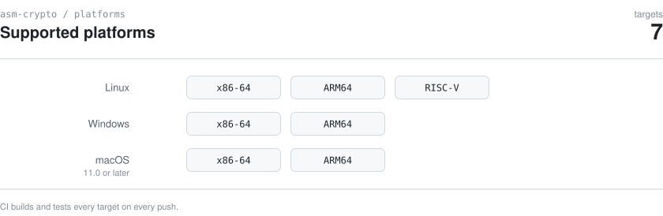
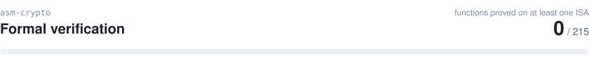
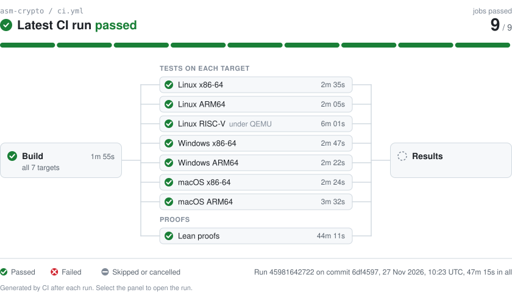
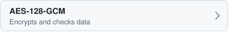
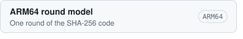
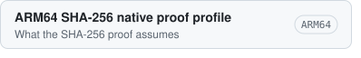
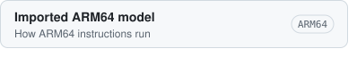
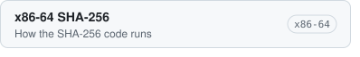

# asm-crypto

The cryptography an Ethereum consensus client needs, written in assembly.

Standard: [asm-standard@0db3e07](https://github.com/bitminetech/asm-standard/blob/0db3e07f58a9ba89c5b6a46925b179de265ee7e8/ARCHITECTURE.md)

<!-- CI generates the supported platforms panel here. -->
<table><tr><td>

<picture><source media="(prefers-color-scheme: dark)" srcset="docs/readme/platforms-dark.svg"></picture>

</td></tr></table>
<!-- End of the supported platforms panel. -->

<!-- CI generates the verification heatmap here. -->
<table><tr><td>

<picture><source media="(prefers-color-scheme: dark)" srcset="docs/heatmap/header-dark.svg"></picture>

<picture><source media="(prefers-color-scheme: dark)" srcset="docs/heatmap/label-aes-dark.svg"></picture><a href="docs/reference/aes.md#function-crypto_aes128_expand"><picture><source media="(prefers-color-scheme: dark)" srcset="docs/heatmap/cell-0-dark.svg"></picture></a><a href="docs/reference/aes.md#function-crypto_aes128_encrypt4"><picture><source media="(prefers-color-scheme: dark)" srcset="docs/heatmap/cell-0-dark.svg"></picture></a><a href="docs/reference/aes.md#function-crypto_aes128_bitslice"><picture><source media="(prefers-color-scheme: dark)" srcset="docs/heatmap/cell-0-dark.svg"></picture></a><a href="docs/reference/aes.md#function-crypto_aes128_sbox"><picture><source media="(prefers-color-scheme: dark)" srcset="docs/heatmap/cell-0-dark.svg"></picture></a><a href="docs/reference/aes.md#function-crypto_aes128_mix"><picture><source media="(prefers-color-scheme: dark)" srcset="docs/heatmap/cell-0-dark.svg"></picture></a> 
<picture><source media="(prefers-color-scheme: dark)" srcset="docs/heatmap/label-bls-signatures-dark.svg"></picture><a href="docs/reference/bls-signatures.md#function-crypto_bls_sk_to_pk"><picture><source media="(prefers-color-scheme: dark)" srcset="docs/heatmap/cell-0-dark.svg"></picture></a><a href="docs/reference/bls-signatures.md#function-crypto_bls_sign"><picture><source media="(prefers-color-scheme: dark)" srcset="docs/heatmap/cell-0-dark.svg"></picture></a><a href="docs/reference/bls-signatures.md#function-crypto_bls_verify"><picture><source media="(prefers-color-scheme: dark)" srcset="docs/heatmap/cell-0-dark.svg"></picture></a><a href="docs/reference/bls-signatures.md#function-crypto_bls_aggregate"><picture><source media="(prefers-color-scheme: dark)" srcset="docs/heatmap/cell-0-dark.svg"></picture></a><a href="docs/reference/bls-signatures.md#function-crypto_bls_fast_aggregate_verify"><picture><source media="(prefers-color-scheme: dark)" srcset="docs/heatmap/cell-0-dark.svg"></picture></a><a href="docs/reference/bls-signatures.md#function-crypto_bls_key_validate"><picture><source media="(prefers-color-scheme: dark)" srcset="docs/heatmap/cell-0-dark.svg"></picture></a><a href="docs/reference/bls-signatures.md#function-crypto_bls_eth_aggregate_pubkeys"><picture><source media="(prefers-color-scheme: dark)" srcset="docs/heatmap/cell-0-dark.svg"></picture></a><a href="docs/reference/bls-signatures.md#function-crypto_bls_eth_fast_aggregate_verify"><picture><source media="(prefers-color-scheme: dark)" srcset="docs/heatmap/cell-0-dark.svg"></picture></a><a href="docs/reference/bls-signatures.md#function-crypto_bls_fast_aggregate_verify_cached"><picture><source media="(prefers-color-scheme: dark)" srcset="docs/heatmap/cell-0-dark.svg"></picture></a><a href="docs/reference/bls-signatures.md#function-crypto_bls_key_cache_fill"><picture><source media="(prefers-color-scheme: dark)" srcset="docs/heatmap/cell-0-dark.svg"></picture></a><a href="docs/reference/bls-signatures.md#function-crypto_bls_secret_key"><picture><source media="(prefers-color-scheme: dark)" srcset="docs/heatmap/cell-0-dark.svg"></picture></a><a href="docs/reference/bls-signatures.md#function-crypto_bls_key_validate_point"><picture><source media="(prefers-color-scheme: dark)" srcset="docs/heatmap/cell-0-dark.svg"></picture></a><a href="docs/reference/bls-signatures.md#function-crypto_bls_aggregate_keys"><picture><source media="(prefers-color-scheme: dark)" srcset="docs/heatmap/cell-0-dark.svg"></picture></a><a href="docs/reference/bls-signatures.md#function-crypto_bls_core_verify"><picture><source media="(prefers-color-scheme: dark)" srcset="docs/heatmap/cell-0-dark.svg"></picture></a><a href="docs/reference/bls-signatures.md#function-crypto_bls_core_verify_point"><picture><source media="(prefers-color-scheme: dark)" srcset="docs/heatmap/cell-0-dark.svg"></picture></a><a href="docs/reference/bls-signatures.md#function-crypto_bls_fast_verify"><picture><source media="(prefers-color-scheme: dark)" srcset="docs/heatmap/cell-0-dark.svg"></picture></a> 
<picture><source media="(prefers-color-scheme: dark)" srcset="docs/heatmap/label-bls12-381-dark.svg"></picture><a href="docs/reference/bls12-381.md#function-crypto_bls_g1_decode"><picture><source media="(prefers-color-scheme: dark)" srcset="docs/heatmap/cell-0-dark.svg"></picture></a><a href="docs/reference/bls12-381.md#function-crypto_bls_g1_compress"><picture><source media="(prefers-color-scheme: dark)" srcset="docs/heatmap/cell-0-dark.svg"></picture></a><a href="docs/reference/bls12-381.md#function-crypto_bls_g1_add"><picture><source media="(prefers-color-scheme: dark)" srcset="docs/heatmap/cell-0-dark.svg"></picture></a><a href="docs/reference/bls12-381.md#function-crypto_bls_g1_neg"><picture><source media="(prefers-color-scheme: dark)" srcset="docs/heatmap/cell-0-dark.svg"></picture></a><a href="docs/reference/bls12-381.md#function-crypto_bls_g2_decode"><picture><source media="(prefers-color-scheme: dark)" srcset="docs/heatmap/cell-0-dark.svg"></picture></a><a href="docs/reference/bls12-381.md#function-crypto_bls_g2_compress"><picture><source media="(prefers-color-scheme: dark)" srcset="docs/heatmap/cell-0-dark.svg"></picture></a><a href="docs/reference/bls12-381.md#function-crypto_bls_fp_mul"><picture><source media="(prefers-color-scheme: dark)" srcset="docs/heatmap/cell-0-dark.svg"></picture></a><a href="docs/reference/bls12-381.md#function-crypto_bls_fp_add"><picture><source media="(prefers-color-scheme: dark)" srcset="docs/heatmap/cell-0-dark.svg"></picture></a><a href="docs/reference/bls12-381.md#function-crypto_bls_fp_sub"><picture><source media="(prefers-color-scheme: dark)" srcset="docs/heatmap/cell-0-dark.svg"></picture></a><a href="docs/reference/bls12-381.md#function-crypto_bls_fp_neg"><picture><source media="(prefers-color-scheme: dark)" srcset="docs/heatmap/cell-0-dark.svg"></picture></a><a href="docs/reference/bls12-381.md#function-crypto_bls_fp_pow"><picture><source media="(prefers-color-scheme: dark)" srcset="docs/heatmap/cell-0-dark.svg"></picture></a><a href="docs/reference/bls12-381.md#function-crypto_bls_fp_inverse"><picture><source media="(prefers-color-scheme: dark)" srcset="docs/heatmap/cell-0-dark.svg"></picture></a><a href="docs/reference/bls12-381.md#function-crypto_bls_fp_sqrt"><picture><source media="(prefers-color-scheme: dark)" srcset="docs/heatmap/cell-0-dark.svg"></picture></a><a href="docs/reference/bls12-381.md#function-crypto_bls_fp_from_bytes"><picture><source media="(prefers-color-scheme: dark)" srcset="docs/heatmap/cell-0-dark.svg"></picture></a><a href="docs/reference/bls12-381.md#function-crypto_bls_fp_canonical"><picture><source media="(prefers-color-scheme: dark)" srcset="docs/heatmap/cell-0-dark.svg"></picture></a><a href="docs/reference/bls12-381.md#function-crypto_bls_fp_to_bytes"><picture><source media="(prefers-color-scheme: dark)" srcset="docs/heatmap/cell-0-dark.svg"></picture></a><a href="docs/reference/bls12-381.md#function-crypto_bls_fp_sign_bit"><picture><source media="(prefers-color-scheme: dark)" srcset="docs/heatmap/cell-0-dark.svg"></picture></a><a href="docs/reference/bls12-381.md#function-crypto_bls_g1_double"><picture><source media="(prefers-color-scheme: dark)" srcset="docs/heatmap/cell-0-dark.svg"></picture></a><a href="docs/reference/bls12-381.md#function-crypto_bls_g1_add_affine"><picture><source media="(prefers-color-scheme: dark)" srcset="docs/heatmap/cell-0-dark.svg"></picture></a><a href="docs/reference/bls12-381.md#function-crypto_bls_g1_mul"><picture><source media="(prefers-color-scheme: dark)" srcset="docs/heatmap/cell-0-dark.svg"></picture></a><a href="docs/reference/bls12-381.md#function-crypto_bls_g1_affine"><picture><source media="(prefers-color-scheme: dark)" srcset="docs/heatmap/cell-0-dark.svg"></picture></a><a href="docs/reference/bls12-381.md#function-crypto_bls_g1_in_subgroup"><picture><source media="(prefers-color-scheme: dark)" srcset="docs/heatmap/cell-0-dark.svg"></picture></a><a href="docs/reference/bls12-381.md#function-crypto_bls_g1_uncompress"><picture><source media="(prefers-color-scheme: dark)" srcset="docs/heatmap/cell-0-dark.svg"></picture></a><a href="docs/reference/bls12-381.md#function-crypto_bls_fp2_add"><picture><source media="(prefers-color-scheme: dark)" srcset="docs/heatmap/cell-0-dark.svg"></picture></a><a href="docs/reference/bls12-381.md#function-crypto_bls_fp2_sub"><picture><source media="(prefers-color-scheme: dark)" srcset="docs/heatmap/cell-0-dark.svg"></picture></a><a href="docs/reference/bls12-381.md#function-crypto_bls_fp2_neg"><picture><source media="(prefers-color-scheme: dark)" srcset="docs/heatmap/cell-0-dark.svg"></picture></a><a href="docs/reference/bls12-381.md#function-crypto_bls_fp2_mul"><picture><source media="(prefers-color-scheme: dark)" srcset="docs/heatmap/cell-0-dark.svg"></picture></a><a href="docs/reference/bls12-381.md#function-crypto_bls_fp2_square"><picture><source media="(prefers-color-scheme: dark)" srcset="docs/heatmap/cell-0-dark.svg"></picture></a> 
<picture><source media="(prefers-color-scheme: dark)" srcset="docs/heatmap/label-dark.svg"></picture><a href="docs/reference/bls12-381.md#function-crypto_bls_fp2_mul_fp"><picture><source media="(prefers-color-scheme: dark)" srcset="docs/heatmap/cell-0-dark.svg"></picture></a><a href="docs/reference/bls12-381.md#function-crypto_bls_fp2_mul_nr"><picture><source media="(prefers-color-scheme: dark)" srcset="docs/heatmap/cell-0-dark.svg"></picture></a><a href="docs/reference/bls12-381.md#function-crypto_bls_fp2_inverse"><picture><source media="(prefers-color-scheme: dark)" srcset="docs/heatmap/cell-0-dark.svg"></picture></a><a href="docs/reference/bls12-381.md#function-crypto_bls_fp2_sqrt"><picture><source media="(prefers-color-scheme: dark)" srcset="docs/heatmap/cell-0-dark.svg"></picture></a><a href="docs/reference/bls12-381.md#function-crypto_bls_fp2_sign_bit"><picture><source media="(prefers-color-scheme: dark)" srcset="docs/heatmap/cell-0-dark.svg"></picture></a><a href="docs/reference/bls12-381.md#function-crypto_bls_g2_double"><picture><source media="(prefers-color-scheme: dark)" srcset="docs/heatmap/cell-0-dark.svg"></picture></a><a href="docs/reference/bls12-381.md#function-crypto_bls_g2_add"><picture><source media="(prefers-color-scheme: dark)" srcset="docs/heatmap/cell-0-dark.svg"></picture></a><a href="docs/reference/bls12-381.md#function-crypto_bls_g2_neg"><picture><source media="(prefers-color-scheme: dark)" srcset="docs/heatmap/cell-0-dark.svg"></picture></a><a href="docs/reference/bls12-381.md#function-crypto_bls_g2_mul"><picture><source media="(prefers-color-scheme: dark)" srcset="docs/heatmap/cell-0-dark.svg"></picture></a><a href="docs/reference/bls12-381.md#function-crypto_bls_g2_affine"><picture><source media="(prefers-color-scheme: dark)" srcset="docs/heatmap/cell-0-dark.svg"></picture></a><a href="docs/reference/bls12-381.md#function-crypto_bls_g2_in_subgroup"><picture><source media="(prefers-color-scheme: dark)" srcset="docs/heatmap/cell-0-dark.svg"></picture></a><a href="docs/reference/bls12-381.md#function-crypto_bls_g2_uncompress"><picture><source media="(prefers-color-scheme: dark)" srcset="docs/heatmap/cell-0-dark.svg"></picture></a><a href="docs/reference/bls12-381.md#function-crypto_bls_fp6_add"><picture><source media="(prefers-color-scheme: dark)" srcset="docs/heatmap/cell-0-dark.svg"></picture></a><a href="docs/reference/bls12-381.md#function-crypto_bls_fp6_sub"><picture><source media="(prefers-color-scheme: dark)" srcset="docs/heatmap/cell-0-dark.svg"></picture></a><a href="docs/reference/bls12-381.md#function-crypto_bls_fp6_neg"><picture><source media="(prefers-color-scheme: dark)" srcset="docs/heatmap/cell-0-dark.svg"></picture></a><a href="docs/reference/bls12-381.md#function-crypto_bls_fp6_mul"><picture><source media="(prefers-color-scheme: dark)" srcset="docs/heatmap/cell-0-dark.svg"></picture></a><a href="docs/reference/bls12-381.md#function-crypto_bls_fp6_mul_v"><picture><source media="(prefers-color-scheme: dark)" srcset="docs/heatmap/cell-0-dark.svg"></picture></a><a href="docs/reference/bls12-381.md#function-crypto_bls_fp6_inverse"><picture><source media="(prefers-color-scheme: dark)" srcset="docs/heatmap/cell-0-dark.svg"></picture></a><a href="docs/reference/bls12-381.md#function-crypto_bls_fp12_mul"><picture><source media="(prefers-color-scheme: dark)" srcset="docs/heatmap/cell-0-dark.svg"></picture></a><a href="docs/reference/bls12-381.md#function-crypto_bls_fp12_square"><picture><source media="(prefers-color-scheme: dark)" srcset="docs/heatmap/cell-0-dark.svg"></picture></a><a href="docs/reference/bls12-381.md#function-crypto_bls_fp12_mul_line"><picture><source media="(prefers-color-scheme: dark)" srcset="docs/heatmap/cell-0-dark.svg"></picture></a><a href="docs/reference/bls12-381.md#function-crypto_bls_fp12_conjugate"><picture><source media="(prefers-color-scheme: dark)" srcset="docs/heatmap/cell-0-dark.svg"></picture></a><a href="docs/reference/bls12-381.md#function-crypto_bls_fp12_inverse"><picture><source media="(prefers-color-scheme: dark)" srcset="docs/heatmap/cell-0-dark.svg"></picture></a><a href="docs/reference/bls12-381.md#function-crypto_bls_fp12_frobenius"><picture><source media="(prefers-color-scheme: dark)" srcset="docs/heatmap/cell-0-dark.svg"></picture></a><a href="docs/reference/bls12-381.md#function-crypto_bls_fp12_cyclotomic_square"><picture><source media="(prefers-color-scheme: dark)" srcset="docs/heatmap/cell-0-dark.svg"></picture></a><a href="docs/reference/bls12-381.md#function-crypto_bls_fp12_cyclotomic_pow"><picture><source media="(prefers-color-scheme: dark)" srcset="docs/heatmap/cell-0-dark.svg"></picture></a><a href="docs/reference/bls12-381.md#function-crypto_bls_miller_double"><picture><source media="(prefers-color-scheme: dark)" srcset="docs/heatmap/cell-0-dark.svg"></picture></a><a href="docs/reference/bls12-381.md#function-crypto_bls_miller_add"><picture><source media="(prefers-color-scheme: dark)" srcset="docs/heatmap/cell-0-dark.svg"></picture></a> 
<picture><source media="(prefers-color-scheme: dark)" srcset="docs/heatmap/label-dark.svg"></picture><a href="docs/reference/bls12-381.md#function-crypto_bls_miller_loop"><picture><source media="(prefers-color-scheme: dark)" srcset="docs/heatmap/cell-0-dark.svg"></picture></a><a href="docs/reference/bls12-381.md#function-crypto_bls_final_exponentiation"><picture><source media="(prefers-color-scheme: dark)" srcset="docs/heatmap/cell-0-dark.svg"></picture></a><a href="docs/reference/bls12-381.md#function-crypto_bls_pairing_check"><picture><source media="(prefers-color-scheme: dark)" srcset="docs/heatmap/cell-0-dark.svg"></picture></a> 
<picture><source media="(prefers-color-scheme: dark)" srcset="docs/heatmap/label-chacha20-poly1305-dark.svg"></picture><a href="docs/reference/chacha20-poly1305.md#function-crypto_chacha20_aead_encrypt"><picture><source media="(prefers-color-scheme: dark)" srcset="docs/heatmap/cell-0-dark.svg"></picture></a><a href="docs/reference/chacha20-poly1305.md#function-crypto_chacha20_aead_decrypt"><picture><source media="(prefers-color-scheme: dark)" srcset="docs/heatmap/cell-0-dark.svg"></picture></a> 
<picture><source media="(prefers-color-scheme: dark)" srcset="docs/heatmap/label-chacha20-dark.svg"></picture><a href="docs/reference/chacha20.md#function-crypto_chacha20_block"><picture><source media="(prefers-color-scheme: dark)" srcset="docs/heatmap/cell-0-dark.svg"></picture></a><a href="docs/reference/chacha20.md#function-crypto_chacha20_xor"><picture><source media="(prefers-color-scheme: dark)" srcset="docs/heatmap/cell-0-dark.svg"></picture></a> 
<picture><source media="(prefers-color-scheme: dark)" srcset="docs/heatmap/label-ctr-dark.svg"></picture><a href="docs/reference/ctr.md#function-crypto_aes128_ctr"><picture><source media="(prefers-color-scheme: dark)" srcset="docs/heatmap/cell-0-dark.svg"></picture></a><a href="docs/reference/ctr.md#function-crypto_aes128_ctr_xor"><picture><source media="(prefers-color-scheme: dark)" srcset="docs/heatmap/cell-0-dark.svg"></picture></a> 
<picture><source media="(prefers-color-scheme: dark)" srcset="docs/heatmap/label-ed25519-dark.svg"></picture><a href="docs/reference/ed25519.md#function-crypto_ed25519_public_key"><picture><source media="(prefers-color-scheme: dark)" srcset="docs/heatmap/cell-0-dark.svg"></picture></a><a href="docs/reference/ed25519.md#function-crypto_ed25519_sign"><picture><source media="(prefers-color-scheme: dark)" srcset="docs/heatmap/cell-0-dark.svg"></picture></a><a href="docs/reference/ed25519.md#function-crypto_ed25519_verify"><picture><source media="(prefers-color-scheme: dark)" srcset="docs/heatmap/cell-0-dark.svg"></picture></a><a href="docs/reference/ed25519.md#function-crypto_ed25519_expand"><picture><source media="(prefers-color-scheme: dark)" srcset="docs/heatmap/cell-0-dark.svg"></picture></a><a href="docs/reference/ed25519.md#function-crypto_ed25519_hash"><picture><source media="(prefers-color-scheme: dark)" srcset="docs/heatmap/cell-0-dark.svg"></picture></a><a href="docs/reference/ed25519.md#function-crypto_ed25519_scalar_reduce"><picture><source media="(prefers-color-scheme: dark)" srcset="docs/heatmap/cell-0-dark.svg"></picture></a><a href="docs/reference/ed25519.md#function-crypto_ed25519_scalar_mul"><picture><source media="(prefers-color-scheme: dark)" srcset="docs/heatmap/cell-0-dark.svg"></picture></a><a href="docs/reference/ed25519.md#function-crypto_ed25519_scalar_add"><picture><source media="(prefers-color-scheme: dark)" srcset="docs/heatmap/cell-0-dark.svg"></picture></a><a href="docs/reference/ed25519.md#function-crypto_ed25519_point_mul"><picture><source media="(prefers-color-scheme: dark)" srcset="docs/heatmap/cell-0-dark.svg"></picture></a><a href="docs/reference/ed25519.md#function-crypto_ed25519_point_add"><picture><source media="(prefers-color-scheme: dark)" srcset="docs/heatmap/cell-0-dark.svg"></picture></a><a href="docs/reference/ed25519.md#function-crypto_ed25519_point_double"><picture><source media="(prefers-color-scheme: dark)" srcset="docs/heatmap/cell-0-dark.svg"></picture></a><a href="docs/reference/ed25519.md#function-crypto_ed25519_point_encode"><picture><source media="(prefers-color-scheme: dark)" srcset="docs/heatmap/cell-0-dark.svg"></picture></a><a href="docs/reference/ed25519.md#function-crypto_ed25519_point_decode"><picture><source media="(prefers-color-scheme: dark)" srcset="docs/heatmap/cell-0-dark.svg"></picture></a><a href="docs/reference/ed25519.md#function-crypto_ed25519_fe_pow"><picture><source media="(prefers-color-scheme: dark)" srcset="docs/heatmap/cell-0-dark.svg"></picture></a><a href="docs/reference/ed25519.md#function-crypto_ed25519_fe_mul"><picture><source media="(prefers-color-scheme: dark)" srcset="docs/heatmap/cell-0-dark.svg"></picture></a><a href="docs/reference/ed25519.md#function-crypto_ed25519_fe_add"><picture><source media="(prefers-color-scheme: dark)" srcset="docs/heatmap/cell-0-dark.svg"></picture></a><a href="docs/reference/ed25519.md#function-crypto_ed25519_fe_sub"><picture><source media="(prefers-color-scheme: dark)" srcset="docs/heatmap/cell-0-dark.svg"></picture></a><a href="docs/reference/ed25519.md#function-crypto_ed25519_fe_freeze"><picture><source media="(prefers-color-scheme: dark)" srcset="docs/heatmap/cell-0-dark.svg"></picture></a> 
<picture><source media="(prefers-color-scheme: dark)" srcset="docs/heatmap/label-gcm-dark.svg"></picture><a href="docs/reference/gcm.md#function-crypto_aes128_gcm_ae"><picture><source media="(prefers-color-scheme: dark)" srcset="docs/heatmap/cell-0-dark.svg"></picture></a><a href="docs/reference/gcm.md#function-crypto_aes128_gcm_ad"><picture><source media="(prefers-color-scheme: dark)" srcset="docs/heatmap/cell-0-dark.svg"></picture></a><a href="docs/reference/gcm.md#function-crypto_aes128_ghash"><picture><source media="(prefers-color-scheme: dark)" srcset="docs/heatmap/cell-0-dark.svg"></picture></a> 
<picture><source media="(prefers-color-scheme: dark)" srcset="docs/heatmap/label-hash-to-curve-dark.svg"></picture><a href="docs/reference/hash-to-curve.md#function-crypto_bls_expand_message_xmd"><picture><source media="(prefers-color-scheme: dark)" srcset="docs/heatmap/cell-0-dark.svg"></picture></a><a href="docs/reference/hash-to-curve.md#function-crypto_bls_hash_to_g2"><picture><source media="(prefers-color-scheme: dark)" srcset="docs/heatmap/cell-0-dark.svg"></picture></a><a href="docs/reference/hash-to-curve.md#function-crypto_bls_xmd"><picture><source media="(prefers-color-scheme: dark)" srcset="docs/heatmap/cell-0-dark.svg"></picture></a><a href="docs/reference/hash-to-curve.md#function-crypto_bls_fp_from_bytes64"><picture><source media="(prefers-color-scheme: dark)" srcset="docs/heatmap/cell-0-dark.svg"></picture></a><a href="docs/reference/hash-to-curve.md#function-crypto_bls_fp2_sgn0"><picture><source media="(prefers-color-scheme: dark)" srcset="docs/heatmap/cell-0-dark.svg"></picture></a><a href="docs/reference/hash-to-curve.md#function-crypto_bls_simple_swu"><picture><source media="(prefers-color-scheme: dark)" srcset="docs/heatmap/cell-0-dark.svg"></picture></a><a href="docs/reference/hash-to-curve.md#function-crypto_bls_swu_g"><picture><source media="(prefers-color-scheme: dark)" srcset="docs/heatmap/cell-0-dark.svg"></picture></a><a href="docs/reference/hash-to-curve.md#function-crypto_bls_iso_map_g2"><picture><source media="(prefers-color-scheme: dark)" srcset="docs/heatmap/cell-0-dark.svg"></picture></a><a href="docs/reference/hash-to-curve.md#function-crypto_bls_psi"><picture><source media="(prefers-color-scheme: dark)" srcset="docs/heatmap/cell-0-dark.svg"></picture></a><a href="docs/reference/hash-to-curve.md#function-crypto_bls_psi2"><picture><source media="(prefers-color-scheme: dark)" srcset="docs/heatmap/cell-0-dark.svg"></picture></a><a href="docs/reference/hash-to-curve.md#function-crypto_bls_g2_mul_neg_x"><picture><source media="(prefers-color-scheme: dark)" srcset="docs/heatmap/cell-0-dark.svg"></picture></a><a href="docs/reference/hash-to-curve.md#function-crypto_bls_clear_cofactor"><picture><source media="(prefers-color-scheme: dark)" srcset="docs/heatmap/cell-0-dark.svg"></picture></a><a href="docs/reference/hash-to-curve.md#function-crypto_bls_hash_to_g2_point"><picture><source media="(prefers-color-scheme: dark)" srcset="docs/heatmap/cell-0-dark.svg"></picture></a> 
<picture><source media="(prefers-color-scheme: dark)" srcset="docs/heatmap/label-hkdf-dark.svg"></picture><a href="docs/reference/hkdf.md#function-crypto_hkdf_extract"><picture><source media="(prefers-color-scheme: dark)" srcset="docs/heatmap/cell-0-dark.svg"></picture></a><a href="docs/reference/hkdf.md#function-crypto_hkdf_expand"><picture><source media="(prefers-color-scheme: dark)" srcset="docs/heatmap/cell-0-dark.svg"></picture></a> 
<picture><source media="(prefers-color-scheme: dark)" srcset="docs/heatmap/label-hmac-dark.svg"></picture><a href="docs/reference/hmac.md#function-crypto_hmac_sha256"><picture><source media="(prefers-color-scheme: dark)" srcset="docs/heatmap/cell-0-dark.svg"></picture></a><a href="docs/reference/hmac.md#function-crypto_hmac_key"><picture><source media="(prefers-color-scheme: dark)" srcset="docs/heatmap/cell-0-dark.svg"></picture></a><a href="docs/reference/hmac.md#function-crypto_hmac_finish"><picture><source media="(prefers-color-scheme: dark)" srcset="docs/heatmap/cell-0-dark.svg"></picture></a> 
<picture><source media="(prefers-color-scheme: dark)" srcset="docs/heatmap/label-keccak-256-dark.svg"></picture><a href="docs/reference/keccak-256.md#function-crypto_keccak256"><picture><source media="(prefers-color-scheme: dark)" srcset="docs/heatmap/cell-0-dark.svg"></picture></a> 
<picture><source media="(prefers-color-scheme: dark)" srcset="docs/heatmap/label-kzg-cells-dark.svg"></picture><a href="docs/reference/kzg-cells.md#function-crypto_kzg_compute_cells"><picture><source media="(prefers-color-scheme: dark)" srcset="docs/heatmap/cell-0-dark.svg"></picture></a><a href="docs/reference/kzg-cells.md#function-crypto_kzg_compute_cells_and_kzg_proofs"><picture><source media="(prefers-color-scheme: dark)" srcset="docs/heatmap/cell-0-dark.svg"></picture></a><a href="docs/reference/kzg-cells.md#function-crypto_kzg_verify_cell_kzg_proof_batch"><picture><source media="(prefers-color-scheme: dark)" srcset="docs/heatmap/cell-0-dark.svg"></picture></a><a href="docs/reference/kzg-cells.md#function-crypto_kzg_recover_cells_and_kzg_proofs"><picture><source media="(prefers-color-scheme: dark)" srcset="docs/heatmap/cell-0-dark.svg"></picture></a><a href="docs/reference/kzg-cells.md#function-crypto_kzg_compute_verify_cell_kzg_proof_batch_challenge"><picture><source media="(prefers-color-scheme: dark)" srcset="docs/heatmap/cell-0-dark.svg"></picture></a><a href="docs/reference/kzg-cells.md#function-crypto_kzg_fft"><picture><source media="(prefers-color-scheme: dark)" srcset="docs/heatmap/cell-0-dark.svg"></picture></a><a href="docs/reference/kzg-cells.md#function-crypto_kzg_shift_vals"><picture><source media="(prefers-color-scheme: dark)" srcset="docs/heatmap/cell-0-dark.svg"></picture></a><a href="docs/reference/kzg-cells.md#function-crypto_kzg_coset_fft"><picture><source media="(prefers-color-scheme: dark)" srcset="docs/heatmap/cell-0-dark.svg"></picture></a><a href="docs/reference/kzg-cells.md#function-crypto_kzg_eval_to_coeff"><picture><source media="(prefers-color-scheme: dark)" srcset="docs/heatmap/cell-0-dark.svg"></picture></a><a href="docs/reference/kzg-cells.md#function-crypto_kzg_extended_cells"><picture><source media="(prefers-color-scheme: dark)" srcset="docs/heatmap/cell-0-dark.svg"></picture></a><a href="docs/reference/kzg-cells.md#function-crypto_kzg_g1_fft"><picture><source media="(prefers-color-scheme: dark)" srcset="docs/heatmap/cell-0-dark.svg"></picture></a><a href="docs/reference/kzg-cells.md#function-crypto_kzg_fk20"><picture><source media="(prefers-color-scheme: dark)" srcset="docs/heatmap/cell-0-dark.svg"></picture></a><a href="docs/reference/kzg-cells.md#function-crypto_kzg_cell_challenge"><picture><source media="(prefers-color-scheme: dark)" srcset="docs/heatmap/cell-0-dark.svg"></picture></a><a href="docs/reference/kzg-cells.md#function-crypto_kzg_check_cell_indices"><picture><source media="(prefers-color-scheme: dark)" srcset="docs/heatmap/cell-0-dark.svg"></picture></a><a href="docs/reference/kzg-cells.md#function-crypto_kzg_interpolate"><picture><source media="(prefers-color-scheme: dark)" srcset="docs/heatmap/cell-0-dark.svg"></picture></a> 
<picture><source media="(prefers-color-scheme: dark)" srcset="docs/heatmap/label-kzg-dark.svg"></picture><a href="docs/reference/kzg.md#function-crypto_kzg_trusted_setup_of_bytes"><picture><source media="(prefers-color-scheme: dark)" srcset="docs/heatmap/cell-0-dark.svg"></picture></a><a href="docs/reference/kzg.md#function-crypto_kzg_blob_to_kzg_commitment"><picture><source media="(prefers-color-scheme: dark)" srcset="docs/heatmap/cell-0-dark.svg"></picture></a><a href="docs/reference/kzg.md#function-crypto_kzg_compute_kzg_proof"><picture><source media="(prefers-color-scheme: dark)" srcset="docs/heatmap/cell-0-dark.svg"></picture></a><a href="docs/reference/kzg.md#function-crypto_kzg_verify_kzg_proof"><picture><source media="(prefers-color-scheme: dark)" srcset="docs/heatmap/cell-0-dark.svg"></picture></a><a href="docs/reference/kzg.md#function-crypto_kzg_compute_blob_kzg_proof"><picture><source media="(prefers-color-scheme: dark)" srcset="docs/heatmap/cell-0-dark.svg"></picture></a><a href="docs/reference/kzg.md#function-crypto_kzg_verify_blob_kzg_proof"><picture><source media="(prefers-color-scheme: dark)" srcset="docs/heatmap/cell-0-dark.svg"></picture></a><a href="docs/reference/kzg.md#function-crypto_kzg_verify_blob_kzg_proof_batch"><picture><source media="(prefers-color-scheme: dark)" srcset="docs/heatmap/cell-0-dark.svg"></picture></a><a href="docs/reference/kzg.md#function-crypto_kzg_compute_challenge"><picture><source media="(prefers-color-scheme: dark)" srcset="docs/heatmap/cell-0-dark.svg"></picture></a><a href="docs/reference/kzg.md#function-crypto_kzg_fr_mul"><picture><source media="(prefers-color-scheme: dark)" srcset="docs/heatmap/cell-0-dark.svg"></picture></a><a href="docs/reference/kzg.md#function-crypto_kzg_fr_add"><picture><source media="(prefers-color-scheme: dark)" srcset="docs/heatmap/cell-0-dark.svg"></picture></a><a href="docs/reference/kzg.md#function-crypto_kzg_fr_sub"><picture><source media="(prefers-color-scheme: dark)" srcset="docs/heatmap/cell-0-dark.svg"></picture></a><a href="docs/reference/kzg.md#function-crypto_kzg_fr_neg"><picture><source media="(prefers-color-scheme: dark)" srcset="docs/heatmap/cell-0-dark.svg"></picture></a><a href="docs/reference/kzg.md#function-crypto_kzg_fr_pow"><picture><source media="(prefers-color-scheme: dark)" srcset="docs/heatmap/cell-0-dark.svg"></picture></a><a href="docs/reference/kzg.md#function-crypto_kzg_fr_inverse"><picture><source media="(prefers-color-scheme: dark)" srcset="docs/heatmap/cell-0-dark.svg"></picture></a><a href="docs/reference/kzg.md#function-crypto_kzg_fr_from_bytes"><picture><source media="(prefers-color-scheme: dark)" srcset="docs/heatmap/cell-0-dark.svg"></picture></a><a href="docs/reference/kzg.md#function-crypto_kzg_fr_from_digest"><picture><source media="(prefers-color-scheme: dark)" srcset="docs/heatmap/cell-0-dark.svg"></picture></a><a href="docs/reference/kzg.md#function-crypto_kzg_fr_from_u64"><picture><source media="(prefers-color-scheme: dark)" srcset="docs/heatmap/cell-0-dark.svg"></picture></a><a href="docs/reference/kzg.md#function-crypto_kzg_fr_canonical"><picture><source media="(prefers-color-scheme: dark)" srcset="docs/heatmap/cell-0-dark.svg"></picture></a><a href="docs/reference/kzg.md#function-crypto_kzg_fr_to_bytes"><picture><source media="(prefers-color-scheme: dark)" srcset="docs/heatmap/cell-0-dark.svg"></picture></a><a href="docs/reference/kzg.md#function-crypto_kzg_roots_of_unity"><picture><source media="(prefers-color-scheme: dark)" srcset="docs/heatmap/cell-0-dark.svg"></picture></a><a href="docs/reference/kzg.md#function-crypto_kzg_bit_reversal"><picture><source media="(prefers-color-scheme: dark)" srcset="docs/heatmap/cell-0-dark.svg"></picture></a><a href="docs/reference/kzg.md#function-crypto_kzg_batch_inverse"><picture><source media="(prefers-color-scheme: dark)" srcset="docs/heatmap/cell-0-dark.svg"></picture></a><a href="docs/reference/kzg.md#function-crypto_kzg_blob_to_poly"><picture><source media="(prefers-color-scheme: dark)" srcset="docs/heatmap/cell-0-dark.svg"></picture></a><a href="docs/reference/kzg.md#function-crypto_kzg_validate_g1"><picture><source media="(prefers-color-scheme: dark)" srcset="docs/heatmap/cell-0-dark.svg"></picture></a><a href="docs/reference/kzg.md#function-crypto_kzg_challenge"><picture><source media="(prefers-color-scheme: dark)" srcset="docs/heatmap/cell-0-dark.svg"></picture></a><a href="docs/reference/kzg.md#function-crypto_kzg_g1_lincomb"><picture><source media="(prefers-color-scheme: dark)" srcset="docs/heatmap/cell-0-dark.svg"></picture></a><a href="docs/reference/kzg.md#function-crypto_kzg_domain"><picture><source media="(prefers-color-scheme: dark)" srcset="docs/heatmap/cell-0-dark.svg"></picture></a><a href="docs/reference/kzg.md#function-crypto_kzg_evaluate"><picture><source media="(prefers-color-scheme: dark)" srcset="docs/heatmap/cell-0-dark.svg"></picture></a> 
<picture><source media="(prefers-color-scheme: dark)" srcset="docs/heatmap/label-dark.svg"></picture><a href="docs/reference/kzg.md#function-crypto_kzg_quotient_in_domain"><picture><source media="(prefers-color-scheme: dark)" srcset="docs/heatmap/cell-0-dark.svg"></picture></a><a href="docs/reference/kzg.md#function-crypto_kzg_proof_impl"><picture><source media="(prefers-color-scheme: dark)" srcset="docs/heatmap/cell-0-dark.svg"></picture></a><a href="docs/reference/kzg.md#function-crypto_kzg_verify_impl"><picture><source media="(prefers-color-scheme: dark)" srcset="docs/heatmap/cell-0-dark.svg"></picture></a> 
<picture><source media="(prefers-color-scheme: dark)" srcset="docs/heatmap/label-p256-dark.svg"></picture><a href="docs/reference/p256.md#function-crypto_p256_public_key"><picture><source media="(prefers-color-scheme: dark)" srcset="docs/heatmap/cell-0-dark.svg"></picture></a><a href="docs/reference/p256.md#function-crypto_p256_ecdh"><picture><source media="(prefers-color-scheme: dark)" srcset="docs/heatmap/cell-0-dark.svg"></picture></a><a href="docs/reference/p256.md#function-crypto_p256_sign"><picture><source media="(prefers-color-scheme: dark)" srcset="docs/heatmap/cell-0-dark.svg"></picture></a><a href="docs/reference/p256.md#function-crypto_p256_verify"><picture><source media="(prefers-color-scheme: dark)" srcset="docs/heatmap/cell-0-dark.svg"></picture></a><a href="docs/reference/p256.md#function-crypto_p256_point_load"><picture><source media="(prefers-color-scheme: dark)" srcset="docs/heatmap/cell-0-dark.svg"></picture></a><a href="docs/reference/p256.md#function-crypto_p256_point_mul"><picture><source media="(prefers-color-scheme: dark)" srcset="docs/heatmap/cell-0-dark.svg"></picture></a><a href="docs/reference/p256.md#function-crypto_p256_point_add"><picture><source media="(prefers-color-scheme: dark)" srcset="docs/heatmap/cell-0-dark.svg"></picture></a><a href="docs/reference/p256.md#function-crypto_p256_point_double"><picture><source media="(prefers-color-scheme: dark)" srcset="docs/heatmap/cell-0-dark.svg"></picture></a><a href="docs/reference/p256.md#function-crypto_p256_point_affine"><picture><source media="(prefers-color-scheme: dark)" srcset="docs/heatmap/cell-0-dark.svg"></picture></a><a href="docs/reference/p256.md#function-crypto_p256_mod_pow"><picture><source media="(prefers-color-scheme: dark)" srcset="docs/heatmap/cell-0-dark.svg"></picture></a><a href="docs/reference/p256.md#function-crypto_p256_mod_mul"><picture><source media="(prefers-color-scheme: dark)" srcset="docs/heatmap/cell-0-dark.svg"></picture></a><a href="docs/reference/p256.md#function-crypto_p256_mod_add"><picture><source media="(prefers-color-scheme: dark)" srcset="docs/heatmap/cell-0-dark.svg"></picture></a><a href="docs/reference/p256.md#function-crypto_p256_mod_sub"><picture><source media="(prefers-color-scheme: dark)" srcset="docs/heatmap/cell-0-dark.svg"></picture></a> 
<picture><source media="(prefers-color-scheme: dark)" srcset="docs/heatmap/label-poly1305-dark.svg"></picture><a href="docs/reference/poly1305.md#function-crypto_poly1305_mac"><picture><source media="(prefers-color-scheme: dark)" srcset="docs/heatmap/cell-0-dark.svg"></picture></a><a href="docs/reference/poly1305.md#function-crypto_poly1305_init"><picture><source media="(prefers-color-scheme: dark)" srcset="docs/heatmap/cell-0-dark.svg"></picture></a><a href="docs/reference/poly1305.md#function-crypto_poly1305_blocks"><picture><source media="(prefers-color-scheme: dark)" srcset="docs/heatmap/cell-0-dark.svg"></picture></a><a href="docs/reference/poly1305.md#function-crypto_poly1305_emit"><picture><source media="(prefers-color-scheme: dark)" srcset="docs/heatmap/cell-0-dark.svg"></picture></a> 
<picture><source media="(prefers-color-scheme: dark)" srcset="docs/heatmap/label-secp256k1-dark.svg"></picture><a href="docs/reference/secp256k1.md#function-crypto_secp256k1_public_key"><picture><source media="(prefers-color-scheme: dark)" srcset="docs/heatmap/cell-0-dark.svg"></picture></a><a href="docs/reference/secp256k1.md#function-crypto_secp256k1_decompress"><picture><source media="(prefers-color-scheme: dark)" srcset="docs/heatmap/cell-0-dark.svg"></picture></a><a href="docs/reference/secp256k1.md#function-crypto_secp256k1_ecdh"><picture><source media="(prefers-color-scheme: dark)" srcset="docs/heatmap/cell-0-dark.svg"></picture></a><a href="docs/reference/secp256k1.md#function-crypto_secp256k1_sign"><picture><source media="(prefers-color-scheme: dark)" srcset="docs/heatmap/cell-0-dark.svg"></picture></a><a href="docs/reference/secp256k1.md#function-crypto_secp256k1_verify"><picture><source media="(prefers-color-scheme: dark)" srcset="docs/heatmap/cell-0-dark.svg"></picture></a><a href="docs/reference/secp256k1.md#function-crypto_secp256k1_lift_x"><picture><source media="(prefers-color-scheme: dark)" srcset="docs/heatmap/cell-0-dark.svg"></picture></a><a href="docs/reference/secp256k1.md#function-crypto_secp256k1_point_mul"><picture><source media="(prefers-color-scheme: dark)" srcset="docs/heatmap/cell-0-dark.svg"></picture></a><a href="docs/reference/secp256k1.md#function-crypto_secp256k1_point_add"><picture><source media="(prefers-color-scheme: dark)" srcset="docs/heatmap/cell-0-dark.svg"></picture></a><a href="docs/reference/secp256k1.md#function-crypto_secp256k1_point_double"><picture><source media="(prefers-color-scheme: dark)" srcset="docs/heatmap/cell-0-dark.svg"></picture></a><a href="docs/reference/secp256k1.md#function-crypto_secp256k1_point_affine"><picture><source media="(prefers-color-scheme: dark)" srcset="docs/heatmap/cell-0-dark.svg"></picture></a><a href="docs/reference/secp256k1.md#function-crypto_secp256k1_mod_pow"><picture><source media="(prefers-color-scheme: dark)" srcset="docs/heatmap/cell-0-dark.svg"></picture></a><a href="docs/reference/secp256k1.md#function-crypto_secp256k1_mod_mul"><picture><source media="(prefers-color-scheme: dark)" srcset="docs/heatmap/cell-0-dark.svg"></picture></a><a href="docs/reference/secp256k1.md#function-crypto_secp256k1_mod_add"><picture><source media="(prefers-color-scheme: dark)" srcset="docs/heatmap/cell-0-dark.svg"></picture></a><a href="docs/reference/secp256k1.md#function-crypto_secp256k1_mod_sub"><picture><source media="(prefers-color-scheme: dark)" srcset="docs/heatmap/cell-0-dark.svg"></picture></a> 
<picture><source media="(prefers-color-scheme: dark)" srcset="docs/heatmap/label-sha-256-dark.svg"></picture><a href="docs/reference/sha-256.md#function-crypto_sha256"><picture><source media="(prefers-color-scheme: dark)" srcset="docs/heatmap/cell-3-dark.svg"></picture></a> 
<picture><source media="(prefers-color-scheme: dark)" srcset="docs/heatmap/label-sha-512-dark.svg"></picture><a href="docs/reference/sha-512.md#function-crypto_sha512"><picture><source media="(prefers-color-scheme: dark)" srcset="docs/heatmap/cell-0-dark.svg"></picture></a><a href="docs/reference/sha-512.md#function-crypto_sha512_init"><picture><source media="(prefers-color-scheme: dark)" srcset="docs/heatmap/cell-0-dark.svg"></picture></a><a href="docs/reference/sha-512.md#function-crypto_sha512_update"><picture><source media="(prefers-color-scheme: dark)" srcset="docs/heatmap/cell-0-dark.svg"></picture></a><a href="docs/reference/sha-512.md#function-crypto_sha512_final"><picture><source media="(prefers-color-scheme: dark)" srcset="docs/heatmap/cell-0-dark.svg"></picture></a><a href="docs/reference/sha-512.md#function-crypto_sha512_blocks"><picture><source media="(prefers-color-scheme: dark)" srcset="docs/heatmap/cell-0-dark.svg"></picture></a> 
<picture><source media="(prefers-color-scheme: dark)" srcset="docs/heatmap/label-x25519-dark.svg"></picture><a href="docs/reference/x25519.md#function-crypto_x25519"><picture><source media="(prefers-color-scheme: dark)" srcset="docs/heatmap/cell-0-dark.svg"></picture></a><a href="docs/reference/x25519.md#function-crypto_x25519_invert"><picture><source media="(prefers-color-scheme: dark)" srcset="docs/heatmap/cell-0-dark.svg"></picture></a><a href="docs/reference/x25519.md#function-crypto_x25519_mul"><picture><source media="(prefers-color-scheme: dark)" srcset="docs/heatmap/cell-0-dark.svg"></picture></a><a href="docs/reference/x25519.md#function-crypto_x25519_mul_a24"><picture><source media="(prefers-color-scheme: dark)" srcset="docs/heatmap/cell-0-dark.svg"></picture></a><a href="docs/reference/x25519.md#function-crypto_x25519_add"><picture><source media="(prefers-color-scheme: dark)" srcset="docs/heatmap/cell-0-dark.svg"></picture></a><a href="docs/reference/x25519.md#function-crypto_x25519_sub"><picture><source media="(prefers-color-scheme: dark)" srcset="docs/heatmap/cell-0-dark.svg"></picture></a><a href="docs/reference/x25519.md#function-crypto_x25519_cswap"><picture><source media="(prefers-color-scheme: dark)" srcset="docs/heatmap/cell-0-dark.svg"></picture></a>

<picture><source media="(prefers-color-scheme: dark)" srcset="docs/heatmap/legend-dark.svg"></picture>

</td></tr></table>
<!-- End of the verification heatmap. -->

<!-- CI generates the CI panel here. -->
<table><tr><td>

<a href="https://github.com/bitminetech/asm-crypto/actions/runs/45981642722"><picture><source media="(prefers-color-scheme: dark)" srcset="docs/readme/ci-dark.svg"></picture></a>

</td></tr></table>
<!-- End of the CI panel. -->

<!-- CI generates the docs panel here. -->
<table><tr><td>

<picture><source media="(prefers-color-scheme: dark)" srcset="docs/readme/docs-header-dark.svg"></picture> 
<picture><source media="(prefers-color-scheme: dark)" srcset="docs/readme/docs-docs-dark.svg"></picture> 
<a href="docs/reference/aes.md"><picture><source media="(prefers-color-scheme: dark)" srcset="docs/readme/docs-doc-aes-dark.svg"></picture></a><a href="docs/reference/ctr.md"><picture><source media="(prefers-color-scheme: dark)" srcset="docs/readme/docs-doc-ctr-dark.svg"></picture></a> 
<a href="docs/reference/gcm.md"><picture><source media="(prefers-color-scheme: dark)" srcset="docs/readme/docs-doc-gcm-dark.svg"></picture></a><a href="docs/reference/bls-signatures.md"><picture><source media="(prefers-color-scheme: dark)" srcset="docs/readme/docs-doc-bls-signatures-dark.svg"></picture></a> 
<a href="docs/reference/bls12-381.md"><picture><source media="(prefers-color-scheme: dark)" srcset="docs/readme/docs-doc-bls12-381-dark.svg"></picture></a><a href="docs/reference/chacha20.md"><picture><source media="(prefers-color-scheme: dark)" srcset="docs/readme/docs-doc-chacha20-dark.svg"></picture></a> 
<a href="docs/reference/chacha20-poly1305.md"><picture><source media="(prefers-color-scheme: dark)" srcset="docs/readme/docs-doc-chacha20-poly1305-dark.svg"></picture></a><a href="docs/reference/ed25519.md"><picture><source media="(prefers-color-scheme: dark)" srcset="docs/readme/docs-doc-ed25519-dark.svg"></picture></a> 
<a href="docs/reference/hash-to-curve.md"><picture><source media="(prefers-color-scheme: dark)" srcset="docs/readme/docs-doc-hash-to-curve-dark.svg"></picture></a><a href="docs/reference/hkdf.md"><picture><source media="(prefers-color-scheme: dark)" srcset="docs/readme/docs-doc-hkdf-dark.svg"></picture></a> 
<a href="docs/reference/hmac.md"><picture><source media="(prefers-color-scheme: dark)" srcset="docs/readme/docs-doc-hmac-dark.svg"></picture></a><a href="docs/reference/keccak-256.md"><picture><source media="(prefers-color-scheme: dark)" srcset="docs/readme/docs-doc-keccak-256-dark.svg"></picture></a> 
<a href="docs/reference/kzg.md"><picture><source media="(prefers-color-scheme: dark)" srcset="docs/readme/docs-doc-kzg-dark.svg"></picture></a><a href="docs/reference/kzg-cells.md"><picture><source media="(prefers-color-scheme: dark)" srcset="docs/readme/docs-doc-kzg-cells-dark.svg"></picture></a> 
<a href="docs/reference/p256.md"><picture><source media="(prefers-color-scheme: dark)" srcset="docs/readme/docs-doc-p256-dark.svg"></picture></a><a href="docs/reference/poly1305.md"><picture><source media="(prefers-color-scheme: dark)" srcset="docs/readme/docs-doc-poly1305-dark.svg"></picture></a> 
<a href="docs/reference/secp256k1.md"><picture><source media="(prefers-color-scheme: dark)" srcset="docs/readme/docs-doc-secp256k1-dark.svg"></picture></a><a href="docs/reference/sha-256.md"><picture><source media="(prefers-color-scheme: dark)" srcset="docs/readme/docs-doc-sha-256-dark.svg"></picture></a> 
<a href="docs/reference/sha-512.md"><picture><source media="(prefers-color-scheme: dark)" srcset="docs/readme/docs-doc-sha-512-dark.svg"></picture></a><a href="docs/reference/x25519.md"><picture><source media="(prefers-color-scheme: dark)" srcset="docs/readme/docs-doc-x25519-dark.svg"></picture></a>

<picture><source media="(prefers-color-scheme: dark)" srcset="docs/readme/docs-models-dark.svg"></picture> 
<a href="docs/models/arm64-round.md"><picture><source media="(prefers-color-scheme: dark)" srcset="docs/readme/docs-model-arm64-round-dark.svg"></picture></a><a href="docs/models/arm64-sha256-native-profile.md"><picture><source media="(prefers-color-scheme: dark)" srcset="docs/readme/docs-model-arm64-sha256-native-profile-dark.svg"></picture></a> 
<a href="docs/models/arm64-imported.md"><picture><source media="(prefers-color-scheme: dark)" srcset="docs/readme/docs-model-arm64-imported-dark.svg"></picture></a><a href="docs/models/x86-64-sha256.md"><picture><source media="(prefers-color-scheme: dark)" srcset="docs/readme/docs-model-x86-64-sha256-dark.svg"></picture></a>

<picture><source media="(prefers-color-scheme: dark)" srcset="docs/readme/docs-footer-dark.svg"></picture>

</td></tr></table>
<!-- End of the docs panel. -->
